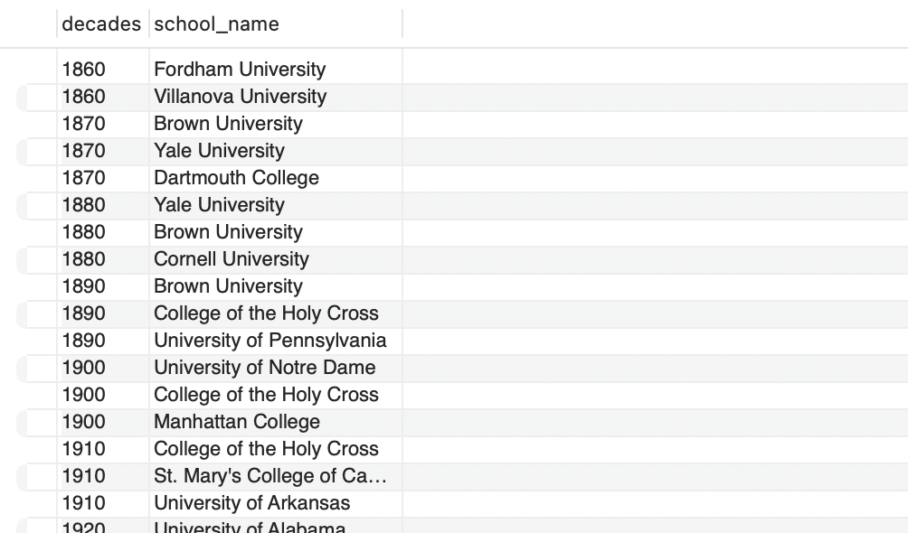
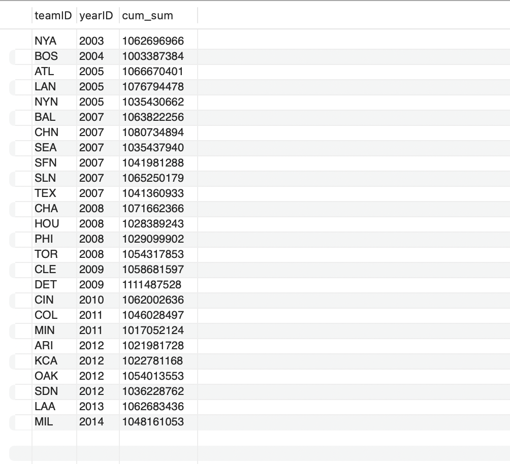
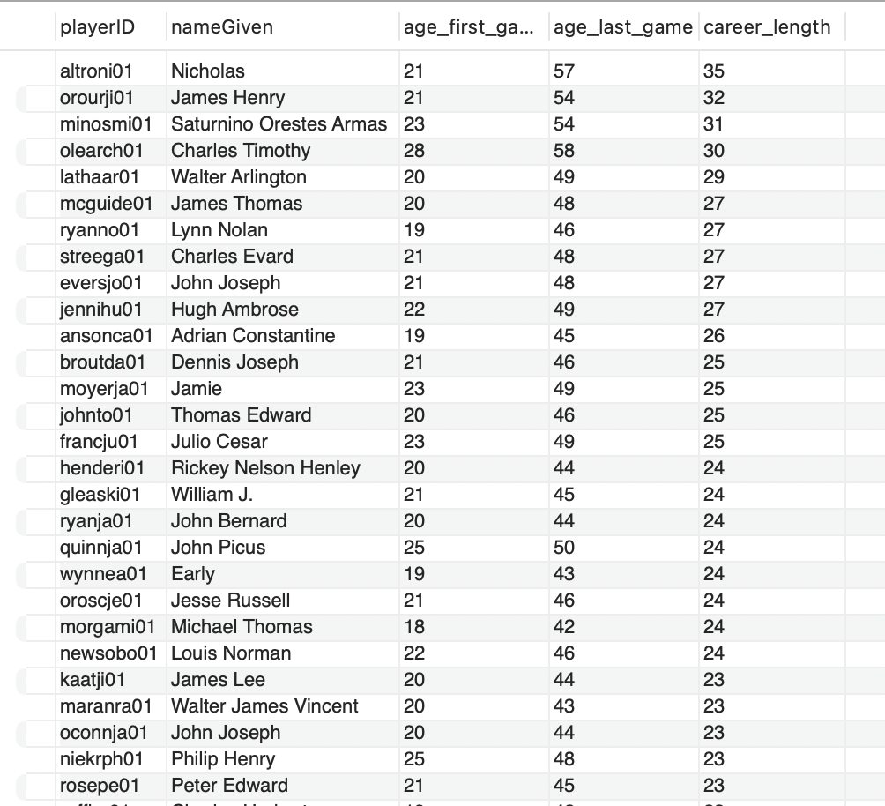
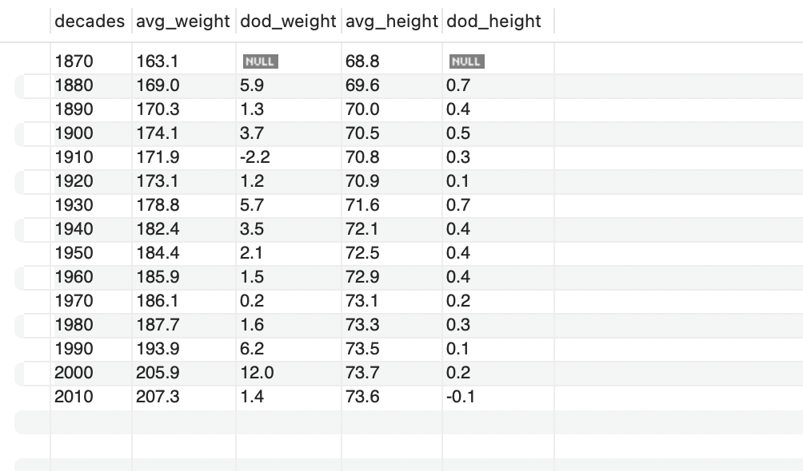

# Baseball Data Analysis with SQL

In this project, I use MySQL to answer questions about baseball players, schools, and team salaries. The main goal is to show how I use SQL to combine, transform, and summarize data.

This is the final project of the course *SQL for Data Analysis: Advanced SQL Querying Techniques* by Maven Analytics. The questions come from the course.

I wrote the SQL queries and ran the analysis myself. I used Claude (AI assistant) to streamline publishing the project: reviewing the queries, drafting this README, and setting up the GitHub repository.

## SQL skills used

- Joins, including joining the same table twice
- Common table expressions (CTEs)
- Window functions: `ROW_NUMBER`, `NTILE`, `LAG`, and `SUM() OVER`
- Aggregation with `GROUP BY` and `HAVING`
- Date calculations with `TIMESTAMPDIFF`
- Conditional calculations with `CASE`
- Combining values with `CONCAT` and `GROUP_CONCAT`

## Data

| Table | Rows | Contents |
|---|---:|---|
| `players` | 18,589 | Player birth dates, height, weight, batting side, first game, and last game |
| `salaries` | 24,758 | Player salaries by team and year (1985–2014) |
| `schools` | 17,350 | Schools that players attended, by year |
| `school_details` | 1,207 | School names and locations |

## Analysis

### Part 1: Schools

[View the queries](queries/01_school_analysis.sql)

- Count the schools that produced players in each decade
- Find the top 5 schools by number of players
- Find the top 3 schools in each decade with `ROW_NUMBER`

The screenshot shows the first rows of the top 3 result:



### Part 2: Salaries

[View the queries](queries/02_salary_analysis.sql)

- Find the top 20% of teams by average annual spending in two ways: `ROW_NUMBER` and `NTILE`
- Calculate each team's cumulative spending over the years
- Find the first year each team's cumulative spending passed $1 billion

The first team to pass $1 billion was `NYA`, in 2003:



### Part 3: Player careers

[View the queries](queries/03_player_career_analysis.sql)

- Calculate each player's age at their first and last game, and their career length
- Find each player's first and last team by joining the salaries table twice
- Count the players who stayed on the same team and played for more than 10 years

The longest career in the result is 35 years. The screenshot shows the first rows:



### Part 4: Player comparison

[View the queries](queries/04_player_comparison_analysis.sql)

- Find players who share a birthday
- Calculate the percentage of each team's players who bat right, left, or both
- Compare average height and weight by decade with `LAG`

From the 1870s to the 2010s, average weight rose from 163.1 lb to 207.3 lb, and average height rose from 68.8 in to 73.6 in:



## Limitations

- **Salary data:** it covers only 1985–2014, and the amounts are not adjusted for inflation.
- **First and last teams:** the `INNER JOIN` keeps only players with a salary record in both their first and last year, so the results do not cover all players. A player who was on more than one team in one of those years can appear more than once.
- **Team IDs:** the same club can appear under more than one `teamID`, which can affect team comparisons.
- **Ties:** `ROW_NUMBER` returns exactly three schools per decade. If schools have the same number of players, the query does not control which one appears.

## How to run

1. Create a new database in MySQL 8 or later.
2. Run [`data/create_statements_final_project.sql`](data/create_statements_final_project.sql) to create and fill the tables.
3. Open a file in `queries/` and run the queries.

## Project structure

```
├── data/       Script that creates the tables and loads the data
├── queries/    SQL queries for each part of the analysis
├── results/    Screenshots of selected results
└── README.md
```
